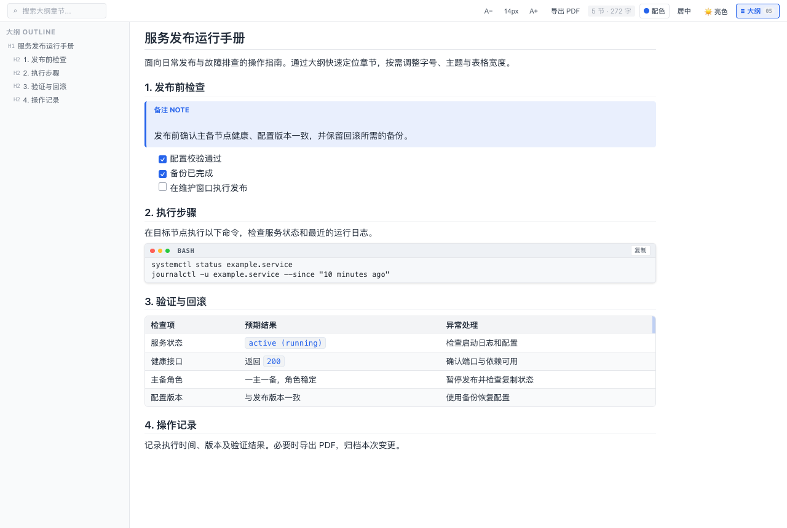
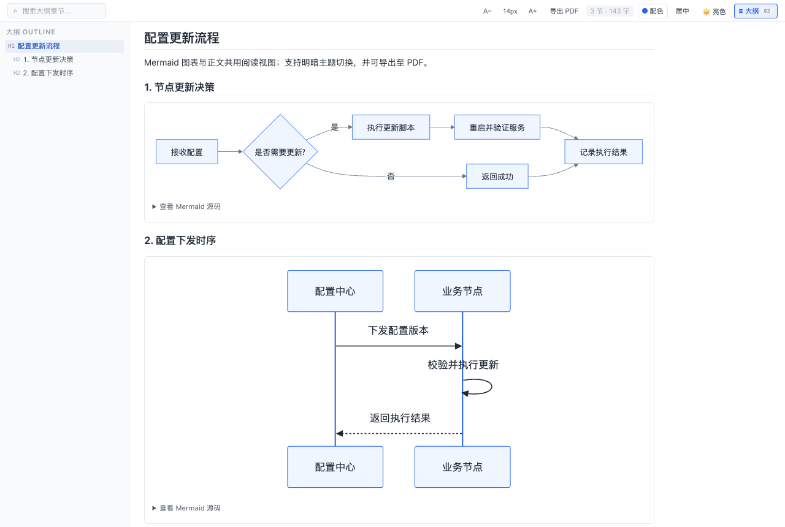

# Markdown Web Preview

面向 **DeepSeek Harness、VS Code 和 Cursor** 的 Markdown 阅读预览插件。提供可调整宽度的大纲导航、实时预览、主题与字号设置，以及基于浏览器打印的 PDF 导出。

项目采用共用渲染组件与独立平台适配层，不替换编辑器，也不覆盖 VS Code / Cursor 的内置 Markdown 预览。

**[下载最新版本](https://github.com/Zelayan/markdown-web-preview/releases/latest)** · **[版本记录](https://github.com/Zelayan/markdown-web-preview/releases)** · **[反馈问题](https://github.com/Zelayan/markdown-web-preview/issues)**

## 界面预览

### 文档阅读

大纲导航、默认蓝色配色、14px 字号、代码复制、提示框及表格阅读视图。



### Mermaid 图表

流程图与时序图直接嵌入正文，下方可展开查看 Mermaid 源码。



> 截图来自当前构建的共用 Webview 在 Chrome 中的真实渲染，使用虚构演示文档；不包含 VS Code / Cursor 外层窗口。截图可通过 `scripts/capture-screenshots.mjs` 重新生成，浏览器配置与 `test:browser` 相同。

## 目录

- [界面预览](#界面预览)

- [主要功能](#主要功能)
- [安装与启动](#安装与启动)
- [平台支持](#平台支持)
- [阅读设置](#阅读设置)
- [Mermaid 图表](#mermaid-图表)
- [PDF 导出](#pdf-导出)
- [开发与构建](#开发与构建)
- [安全与限制](#安全与限制)
- [常见问题](#常见问题)
- [版本摘要](#版本摘要)

## 主要功能

| 功能 | 说明 |
| --- | --- |
| 大纲导航 | 多级标题、中文锚点、目录搜索、当前章节高亮与平滑定位 |
| 可调整大纲 | 拖拽或键盘调整宽度，双击恢复默认，自动保存宽度 |
| 阅读排版 | 分层标题、段落间距、居中或通栏布局、阅读进度与字数统计 |
| 字号设置 | 12–22px，每次调整 0.5px；正文、标题、表格与代码按比例缩放 |
| 主题与配色 | 浅色、深色、自动模式；六种强调色；代码块与主题联动 |
| Markdown 渲染 | 表格、任务清单、GitHub 风格提示框、代码语言标签与复制按钮 |
| 表格宽度 | 表头列边界调整列宽，最右侧蓝色边缘按比例调整整表；双击恢复自动宽度；仅当前预览会话记忆，不修改 Markdown，PDF 使用独立自动排版 |
| Mermaid 图表 | 将 Mermaid 围栏渲染为 SVG 图片，支持主题切换、源码查看和 PDF 导出 |
| 实时预览 | VS Code / Cursor 同步未保存内容；Harness 使用宿主资源监听 |
| PDF 导出 | 独立 A4 打印排版，保留配色并移除阅读界面控件 |

默认阅读设置为 **蓝色配色、浅色背景、14px 字号**。升级不会覆盖已保存的有效偏好。

## 安装与启动

### VS Code / Cursor

要求 VS Code API 版本 **1.85.0 或更高**；Cursor 需提供兼容的扩展 API。

1. 从 [GitHub Releases](https://github.com/Zelayan/markdown-web-preview/releases/latest) 下载 `.vsix` 安装包。
2. 打开扩展面板，选择 **⋯ → Install from VSIX…（从 VSIX 安装）**。
3. 安装后打开 Markdown 文件，在正文右键菜单选择 **Markdown: 打开增强预览**。

也可以通过以下入口打开预览：

- 命令面板：搜索 **Markdown: 打开增强预览**。
- Markdown 编辑器右上角的预览按钮。
- 文件树中的 Markdown 文件右键菜单。

预览默认在当前编辑器组的新标签中打开，不自动分栏，原 Markdown 标签仍保留。预览绑定到对应文件；再次打开同一文件会复用已有面板并显示到当前组。需要并排查看时，可自行拖动预览标签到其他编辑器组。当前通过 GitHub 分发安装包，**未发布到 VS Code Marketplace**。

更新时安装新版 VSIX 即可。如果界面仍为旧版，执行 **Developer: Reload Window**，然后重新打开增强预览。

### DeepSeek Harness

支持在线 npm 安装与离线环境安装。所有依赖已预先打包至单文件组件中，运行时**不发起任何外部网络请求**。

#### 方式一：在线安装（推荐）

- **通过 Web 界面**：打开 Harness 侧边栏的 **插件** 页面，点击 **添加插件**，输入 `@zelayan/markdown-web-preview` 并点击 **安装**，完成后选择 **立即启用**。
- **通过命令行**：
  ```sh
  dsh plugin add @zelayan/markdown-web-preview
  ```

#### 方式二：通过 Harness 插件界面安装离线包

1. 从 [GitHub Releases](https://github.com/Zelayan/markdown-web-preview/releases/latest) 下载 `zelayan-markdown-web-preview-<版本>.tgz` 安装包。
2. 打开 Harness 侧边栏的 **插件** 页面，点击 **添加插件**。
3. 在包名/路径输入框中填写下载的 `.tgz` 文件的**本机绝对路径**（例如 `/Users/yourname/Downloads/zelayan-markdown-web-preview-0.4.3.tgz`）。
4. 点击 **安装**，完成后选择 **立即启用**。
5. 打开 `.md` 或 `.markdown` 文件，在右侧文档预览下拉框中选择 **网页阅读**。

#### 方式三：使用零依赖离线安装器（纯 Node 环境 / 机器完全断网）

适合无法运行 `pnpm` 或没有公网访问权限的离线机器：

1. 从 Releases 下载解压离线包 `markdown-web-preview-<版本>-offline.zip`（包含 `package/`、`manifest.json` 与 `install.cjs`）。
2. **完全退出目标 DeepSeek Harness** 及其后台进程。
3. 运行专用安装器：
   ```bash
   # macOS / Linux
   node install.cjs --profile ~/.dsh/profiles/desktop --host-stopped

   # Windows
   node install.cjs --profile "$env:USERPROFILE\.dsh\profiles\desktop" --host-stopped
   ```
   > 若需要更新已安装的版本，可追加 `--force` 参数。
4. 安装器会自动校验 SHA-256 完整性清单，安全备份 profile 配置，将插件写入本地 `offline-packages` 并完成登记。
5. 重启 DeepSeek Harness 即可直接使用。

#### 方式四：本地项目目录安装

1. 克隆本仓库并完成构建（产物位于 `lib/client.js`）。
2. 在 Harness 插件页选择添加插件，输入项目根目录的绝对路径。
3. 安装并启用。

> 插件安装影响当前 profile 下的会话。仅修改工作区代码不会自动更新已安装插件；更新后可能需要刷新 GUI 或重启 Harness。

## 平台支持

| 行为 | Harness | VS Code / Cursor |
| --- | --- | --- |
| 打开方式 | 文档查看器中的「网页阅读」 | 命令、正文右键、文件树右键、编辑器按钮 |
| 内容更新 | 保存后依赖宿主资源监听 | 停止编辑约 120ms 后同步，无需保存 |
| 长文加载 | 沿用宿主分页机制 | 使用当前文档全文 |
| 自动主题 | 跟随系统明暗模式 | 跟随编辑器明暗模式 |
| HTTP(S) 图片 | 支持 | 支持 |
| 相对路径图片 | 显示 alt 文本占位 | 支持文档所在目录及其子目录 |
| PDF 打印入口 | 打开浏览器打印页面 | 经扩展宿主打开系统临时打印页面 |

外部程序修改文件后，VS Code / Cursor 将磁盘变更同步到文档时，预览会随之更新。存在未保存编辑或文件冲突时，应先按编辑器提示处理。

## 阅读设置

工具栏提供以下操作：

- **A− / A+**：减小或增大字号；点击中间的字号数值恢复 **14px**。
- **配色**：选择紫、蓝、绿、橙、红或灰色强调色。行内代码、链接与列表序号跟随所选配色。
- **主题**：切换浅色、深色或自动模式。多行代码块的背景、文字和控件跟随明暗主题。
- **居中 / 通栏**：切换正文宽度。
- **大纲**：展开或收起目录；拖动目录边界调整宽度，双击恢复默认。

大纲宽度范围为 140–420px，并受可用视口宽度限制。字号调整仅作用于正文阅读区域，工具栏和大纲字号保持不变。

阅读偏好会保存。需要使用新版默认外观时，手动选择蓝色、浅色，并点击字号数值恢复默认即可。

## Mermaid 图表

使用 `mermaid` 语言标记的代码围栏即可渲染图表：

````markdown

````

- Mermaid 11 随插件打包，无需外部 CDN；已实际验证流程图与时序图。
- 图表跟随浅色/深色主题，浅色使用蓝灰色系。图表颜色暂不跟随六种强调色选择。
- 渲染结果为隔离的 SVG 图片，可展开「查看 Mermaid 源码」并复制源码。
- 修改文档后重新渲染；切换主题时重新生成图表。过期任务不会覆盖新文档。
- 语法错误会显示提示并保留代码，不阻断正文或其他图表；建议给包含特殊字符的节点标签加双引号。
- PDF 使用已完成的浅色图表，不打印折叠源码。图表尚未完成时暂时禁用导出。

安全边界：使用 Mermaid strict 模式，不绑定点击交互，不支持 HTML 标签、外部图表图片、初始化指令或 YAML frontmatter 配置；源码最多 50,000 字符，最多 500 条边。复杂图表、数学公式及全部 Mermaid 图类型尚未逐一验证。

## PDF 导出

### 操作步骤

1. 在预览工具栏点击 **导出 PDF**。
2. 浏览器打开打印版后，点击 **打印 / 保存为 PDF**。
3. 在打印窗口选择 **另存为 PDF**。
4. 在 **更多设置** 中勾选 **背景图形**，以保留代码、表格和提示框背景色。

本功能使用浏览器打印能力，**需要手动确认保存**，不是直接生成文件的 PDF 引擎。浏览器或系统的打印选项可能覆盖页面的颜色设置。

### 打印排版

- 默认 A4 纸张和浅色页面，移除大纲、工具栏、复制按钮及终端装饰。
- 行内代码、链接和列表序号使用导出时所选配色；提示框保留语义颜色。
- 多行代码采用浅灰底、细边框、灰蓝左边线与等宽字体，长行自动换行。
- 隐藏 `text`、`txt`、`plain`、`plaintext` 和默认代码语言标签；保留 `bash`、`json` 等明确语言标签。
- 表格设置重复表头，尽量避免行跨页拆分；最终分页由浏览器决定。
- 使用独立打印字号，**不跟随阅读字号调节**。

打印页面是导出时的静态快照。修改文档或配色后需重新导出，旧打印页面不会自动更新。Harness 分页文档尚未加载完整时禁用导出，避免遗漏后续内容。

VS Code / Cursor 会把打印页面写入系统临时目录，再通过系统文件关联打开。此流程依赖本机浏览器或 HTML 关联程序；远程扩展宿主场景尚未验证。

## 开发与构建

### 环境准备

需要 Node.js 与 pnpm。依赖的 Node.js 版本要求以安装时各包的 `engines` 声明为准。

```sh
git clone https://github.com/Zelayan/markdown-web-preview.git
cd markdown-web-preview
pnpm install
pnpm run build
pnpm test
```

### 项目结构

```text
src/
  client.js              # Harness 入口
  preview.js             # 共用阅读组件
  render.js              # Markdown 解析与安全处理
  mermaid.js             # 图表渲染队列与 SVG 安全处理
  styles.js              # 共用阅读样式
  resize.js              # 布局与阅读偏好
  vscode-webview.js       # VS Code / Cursor Webview 入口
vscode/
  extension.cjs          # 扩展宿主、文档监听与消息桥接
  print-html.cjs         # 两端共用的打印页面生成器
  package.json           # VS Code 扩展清单
scripts/
  build.mjs              # 双平台构建
test/                    # 自动化测试
```

### 构建命令

| 命令 | 用途 |
| --- | --- |
| `pnpm run build` | 构建两个平台（`lib/client.js` 与 `vscode/webview.js`） |
| `pnpm run build:harness` | 仅构建 Harness 客户端脚本 |
| `pnpm run build:vscode` | 仅构建 VS Code / Cursor Webview |
| `pnpm run package:offline` | **一键打包所有离线分发物**（Harness 目录 + `.tgz`、VS Code `.vsix` 及校验清单） |
| `pnpm test` | 执行全套自动化单元与集成测试（含离线安装与安全校验） |
| `pnpm run test:browser` | 验证真实 Chromium 中的图表、主题与 PDF |

构建产物为 `lib/client.js` 和 `vscode/webview.js`。修改组件、渲染逻辑或样式后，应重新构建。离线安装分发文件生成至 `dist/` 目录。

### 制作离线分发包

联网环境下执行：

```sh
pnpm run package:offline
```

脚本将在 `dist/` 目录下生成：
1. `markdown-web-preview-<版本>-offline/`：含 `package/`、`manifest.json` 与单文件零依赖安装器 `install.cjs`，可直接复制到完全断网的机器上运行。
2. `local-markdown-web-preview-<版本>.tgz`：适用于 Harness 插件页面直接输入路径安装。
3. `markdown-web-preview-<版本>.vsix`：适用于 VS Code / Cursor 离线扩展安装。
4. `SHA256SUMS.txt`：各分发产物的 SHA-256 校验码清单。

也可以使用标准的 VSIX 打包工具：

```sh
cd vscode
pnpm dlx @vscode/vsce package --allow-missing-repository --skip-license --no-dependencies
```

VSIX 作为 GitHub Release 附件分发，不提交到源码仓库。当前打包命令允许缺少 repository 字段并跳过 license 检查，不代表已满足 Marketplace 发布要求。

## 安全与限制

### 内容处理

- 仅允许 `<br>` 换行及简单 `<span id="…">` 锚点（不含事件或样式属性）；其他 Markdown 原生 HTML 以文字显示，不作为可执行标记渲染。
- 使用 DOMPurify 过滤危险标签和属性，并限制链接与图片协议。
- VS Code Webview 使用 CSP 限制脚本来源，剪贴板写入经扩展宿主执行。
- 相对路径图片限定在文档所在目录及子目录内，不支持绝对路径或向上跳转。
- HTTP(S) 远程图片仍会产生网络请求；敏感文档应注意远程资源来源。

### 尚未支持

- 代码语法高亮。
- Wiki 双链解析。
- 编辑器与预览双向滚动同步。
- 无交互、直接生成 PDF 文件。

### 验证范围

v0.4.3 包含 **38 项自动化测试**，覆盖 Harness 插件注册与交互、Markdown 渲染安全、VS Code API 消息通道、阅读偏好、Mermaid 图表转换、打印版排版、Obsidian 风格分割线、以及离线包文件摘要与自包含安全安装校验。

另外使用本机 Chrome 验证了打包后的 Webview：真实流程图与时序图、SVG 图片加载、错误容错、深色切换及含图表 PDF 输出。VS Code 扩展宿主 API 仍使用 mock 测试；实际 VS Code / Cursor 版本、本地图片、Harness 宿主 CSP 和复杂图表分页效果仍需各自环境验收。

## 常见问题

### 找不到「打开增强预览」命令

确认扩展 **Markdown Web Preview** 已安装并启用，打开 Markdown 文件，再从命令面板搜索「增强预览」。必要时执行 **Developer: Reload Window**。其他插件提供的预览命令不属于本扩展。

### 更新后没有使用蓝色、浅色或 14px

更新会保留已有有效偏好。请在工具栏手动选择配色和主题，并点击字号数值恢复默认。

### PDF 背景色消失或配色没有变化

在打印设置中开启「背景图形」。切换配色后需重新导出，并使用新打开的打印页面保存。

### PDF 字号为什么不随阅读字号变化

阅读视图和打印版使用独立排版，避免屏幕缩放破坏 A4 分页。当前字号控件只调整阅读区域。

### 相对路径图片为什么不显示

Harness 版不加载相对路径图片。VS Code / Cursor 版仅允许文档所在目录及子目录，请检查路径、文件是否存在，以及是否包含 `../` 向上跳转。

## 版本摘要

| 版本 | 主要变更 |
| --- | --- |
| [v0.4.3](https://github.com/Zelayan/markdown-web-preview/releases/tag/v0.4.3) | 新增自包含离线安装支持（Harness 本地 .tgz 与零依赖 node install.cjs 安装器）、一键离线打包；Obsidian 风格沉浸式分割线排版优化；自动化测试增至 38 项 |
| [v0.4.2](https://github.com/Zelayan/markdown-web-preview/releases/tag/v0.4.2) | 列宽与整表宽度拖拽、键盘微调、双击重置；README 真实界面截图及可重现截图脚本 |
| [v0.4.1](https://github.com/Zelayan/markdown-web-preview/releases/tag/v0.4.1) | 预览默认在当前编辑器组的新标签中打开，不再自动分栏；复用已有面板并定位到当前组 |
| [v0.4.0](https://github.com/Zelayan/markdown-web-preview/releases/tag/v0.4.0) | Mermaid SVG 图表、明暗主题、图表 PDF 导出、错误容错、生产压缩及浏览器验证；补齐 span 锚点写法 |
| [v0.3.12](https://github.com/Zelayan/markdown-web-preview/releases/tag/v0.3.12) | 修复表格 `<br>` 换行与简单 `span` 锚点；专业化 README；HTML 白名单安全回归测试 |
| [v0.3.11](https://github.com/Zelayan/markdown-web-preview/releases/tag/v0.3.11) | 字号调节；默认蓝色、浅色背景、14px；偏好回归测试 |
| [v0.3.8](https://github.com/Zelayan/markdown-web-preview/releases/tag/v0.3.8) | 彩色 PDF 打印导出、打印代码块排版、主题与配色同步 |
| [v0.3.1](https://github.com/Zelayan/markdown-web-preview/releases/tag/v0.3.1) | VS Code / Cursor 侧边预览适配及 Markdown 正文右键入口 |

完整发布记录及安装包见 [GitHub Releases](https://github.com/Zelayan/markdown-web-preview/releases)。
